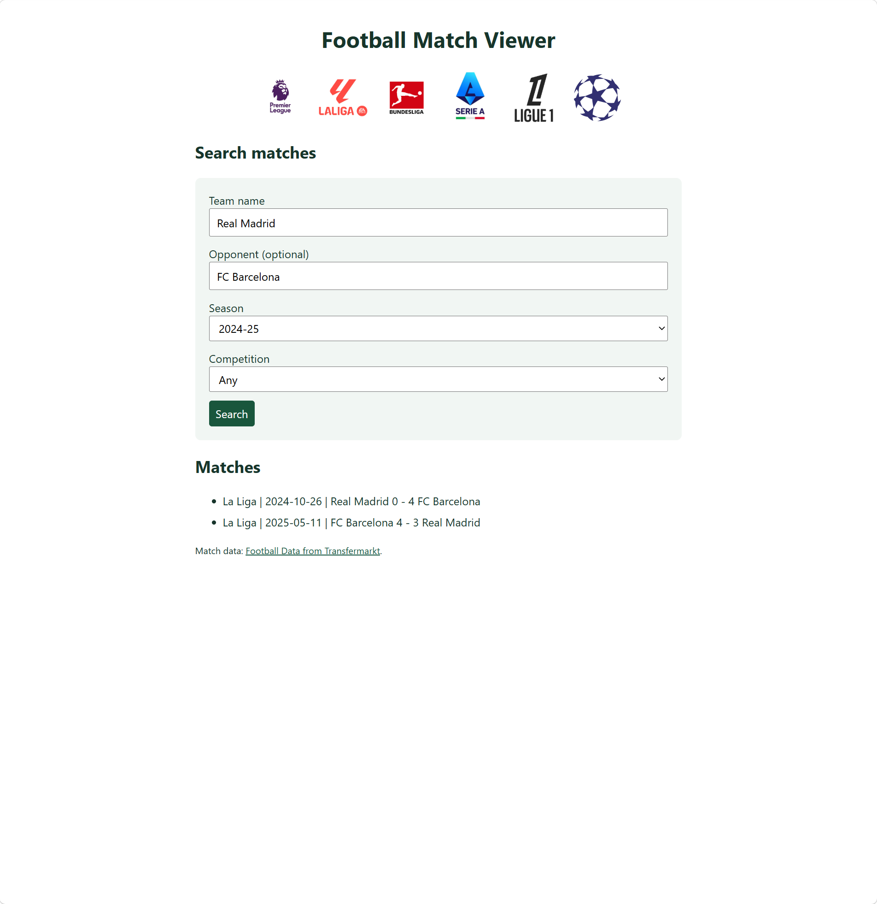

# Football (Soccer) Match Viewer

#### CS50

This is my final project for CS50.

#### Description:

As a football (Soccer) fan, I often want to know how two teams have done against each other before I watch them play. Football Match Viewer makes that quick. It lets you look up results from Europe's top five leagues (Premier League, La Liga, Bundesliga, Serie A and Ligue 1) and the Champions League. The data covers 14 seasons, from 2012-13 to 2025-26. You can search in the terminal or on a small local website built with Flask.



## Features

- Search for a team to see all of its matches and scores.
- Add an opponent to see only the games between those two teams, home and away.
- On the website, filter by season and competition, or choose **Any** to search all of them.
- Type team names loosely. Capital letters, extra spaces and "FC" or "CF" are ignored, so `barcelona` finds **FC Barcelona**.

## Files

- [project.py](project.py) contains the search logic and the terminal version of the program. It defines the `Match` class and the `normalize`, `filter_matches` and `load_csv` functions.
- [clean_matches.py](clean_matches.py) prepares the data. It reads the raw `games.csv`, keeps the six competitions, turns seasons like `2024` into `2024-25`, sorts the matches by date and saves them in `matches_clean.csv`.
- [app.py](app.py) runs the website. It loads the cleaned matches once at startup, reads the search form and uses `filter_matches` from `project.py` to find results.
- [templates/home.html](templates/home.html) is the web page. It shows the competition logos, the search form and the results.
- [Logo/](Logo/) holds the competition logos.
- [run_web.py](run_web.py) starts the local website.
- [test_project.py](test_project.py) contains the pytest tests. They check name normalization, searches with and without an opponent, and how matches are displayed, including 0-0 draws and games not yet played.

## Data

The match data comes from David Cariboo's [Football Data from Transfermarkt](https://www.kaggle.com/datasets/davidcariboo/player-scores?select=games.csv) on Kaggle.

The website uses a local CSV file, so new match results appear only when the file is updated.

## How to Use

### Website

1. Enter a team name.
2. Enter an opponent if you only want games between the two teams. Leave it empty to see all of the team's matches.
3. Choose a season and a competition, or choose **Any** to search all of them.
4. Click **Search**.

Each result shows the competition, date, teams and score. For example, **Real Madrid** against **Barcelona** in **2024-25** shows two La Liga matches, as in the screenshot above.

### Terminal

Enter a team, then an opponent (or press Enter to skip), then a season such as `2024-25`:

```
Enter the first team:
real madrid
Enter the second team: (press Enter to search for all matches)
barcelona
Enter the season (e.g., 2025-26):
2024-25
2024-10-26 | Real Madrid 0 - 4 FC Barcelona
2025-05-11 | FC Barcelona 4 - 3 Real Madrid
```

## Credit to CS50

Thanks to the CS50 team for their amazing course!

[CS50x: Introduction to Computer Science](https://cs50.harvard.edu/x/)
